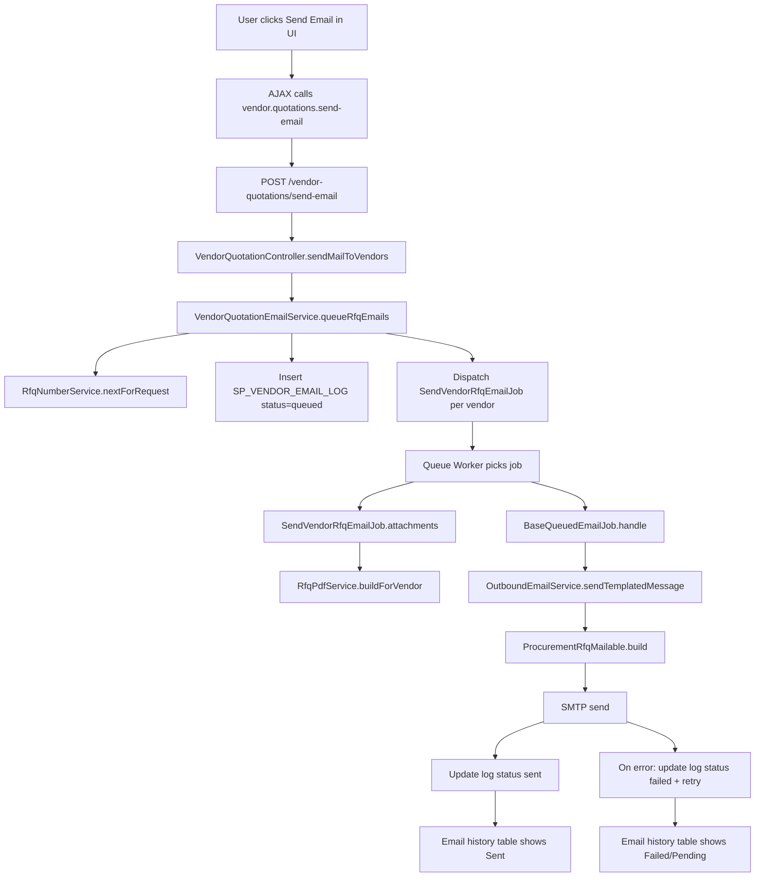

# Vendor Email Only - End-to-End Flow (File by File, Function by Function)

## Scope
Yeh document **sirf vendor email sending flow** explain karta hai:
- button click se start
- queue job process
- SMTP send
- DB log status update (`queued` -> `sent` / `failed`)

---

## 1) Entry Points (UI)

User yahan se "Send Email" action trigger karta hai:

1. `resources/views/store_procurement/quotation_request/sp_quotation_submit.blade.php` (line ~776)
2. `resources/views/store_procurement/quotation_request/po_list.blade.php` (line ~654)

Dono files AJAX me yeh route call karti hain:
- `route('vendor.quotations.send-email')`

---

## 2) Route Mapping

- File: `routes/procurement/procurement.api.php` (line ~103)
- Route:

```php
Route::post('/vendor-quotations/send-email', [VendorQuotationController::class, 'sendMailToVendors'])
    ->name('vendor.quotations.send-email');
```

---

## 3) Controller Function

- File: `app/Http/Controllers/StoreProcurement/VendorQuotationController.php` (line ~469)
- Function: `sendMailToVendors(Request $request, VendorQuotationEmailService $vendorQuotationEmailService)`

### Controller ka kaam
1. Input validate karta hai:
   - `request_id` (integer)
   - `vendors` (array, min 1)
2. Sender username resolve karta hai (`Auth::user()`)
3. Service call karta hai:
   - `queueRfqEmails($requestId, $vendors, $sentBy)`
4. JSON response return karta hai (`queued`, `skipped`, `rfq_number`)

### Example request payload
```json
{
  "request_id": 123,
  "vendors": [5, 9]
}
```

### Example response payload
```json
{
  "message": "Email jobs queued for 2 vendor(s).",
  "queued": 2,
  "skipped": 0,
  "rfq_number": "RFQ-123-101"
}
```

---

## 4) Service Orchestration

- File: `app/Services/StoreProcurement/VendorQuotationEmailService.php`
- Function: `queueRfqEmails(int $requestId, array $vendorIds, string $sentBy)` (line ~29)

### Service ka kaam
1. Vendor IDs clean karta hai (empty remove, int cast, unique)
2. `QuotationRequest` fetch karta hai
3. RFQ number banata hai using:
   - `RfqNumberService::nextForRequest()`
4. Vendor list fetch karta hai
5. Har vendor ke liye:
   - email check (missing ho to skip)
   - Oracle sequence se `ve_id` generate:
     - `sp_vendor_email_log_seq.NEXTVAL`
   - `SP_VENDOR_EMAIL_LOG` me row insert with status `queued`
   - `SendVendorRfqEmailJob::dispatch(...)`
6. Summary return karta hai (`queued`, `skipped`, `rfq_number`)

### Example log row at queue time
```text
ve_id: 90123
ve_qr_id: 123
ve_vendor_id: 5
ve_status: queued
ve_rfq_no: RFQ-123-101
ve_remarks: Email queued for vendor quotation submission (Version 2).
```

---

## 5) RFQ Number Service

- File: `app/Services/StoreProcurement/RfqNumberService.php`
- Function: `nextForRequest(int $requestId)` (line ~16)

### Kaam
- Last RFQ read karta hai from `SP_VENDOR_EMAIL_LOG`
- Counter increment karta hai
- Format return karta hai: `RFQ-{requestId}-{counter}`

### Example
- Last: `RFQ-123-101`
- New: `RFQ-123-102`

---

## 6) Queue Job (Vendor-Specific)

- File: `app/Jobs/Email/SendVendorRfqEmailJob.php` (class at line ~9)
- Parent: `BaseQueuedEmailJob`

### Key overridden functions
1. `viewName()` -> `emails.store_procurement.vendor_rfq`
2. `viewData()` -> vendor name, RFQ number, item title, portal URL
3. `attachments()` -> runtime RFQ PDF build karke return karta hai

PDF yahan se banti hai:
- `app/Services/StoreProcurement/RfqPdfService.php`
- function `buildForVendor(...)` (line ~11)

---

## 7) Common Base Job Pipeline

- File: `app/Jobs/Email/BaseQueuedEmailJob.php`
- Function: `handle(OutboundEmailService $outboundEmailService)` (line ~36)

### Base flow
1. `sendTemplatedMessage(...)` call
2. success pe:
   - `markLog('sent', successRemark)`
3. failure pe:
   - `markLog('failed', failureRemark)`
   - exception rethrow (queue retry policy apply)

Retry setup:
- `tries = 3`
- `timeout = 120`

---

## 8) Outbound Mail Service + Mailable

### 8.1 Outbound Service
- File: `app/Services/Communication/OutboundEmailService.php`
- Function: `sendTemplatedMessage(...)` (line ~18)

Kaam:
- `Mail::to(...)->send(...)` call karta hai

### 8.2 Mailable
- File: `app/Mail/ProcurementRfqMailable.php`
- Function: `build()` (line ~29)

Kaam:
1. Blade render
2. in-memory attachment(s) add
3. final email object return

### 8.3 Email template
- File: `resources/views/emails/store_procurement/vendor_rfq.blade.php`

---

## 9) Status Visibility (UI)

### 9.1 Email history rendering
- Controller function:
  - `VendorQuotationController::getEmailHistory()` (line ~492)
- View:
  - `resources/views/store_procurement/quotation_request/partials/email_history_table.blade.php`

### 9.2 Status badges
`ve_status` ke hisaab se:
- `sent` -> green badge
- `failed` -> red badge
- other (including `queued`) -> pending badge

### 9.3 PDF preview link
History table me PDF button route:
- `quotation-request.rfq-pdf`
- route definition:
  - `routes/procurement/procurement.web.php` line ~129

---

## 10) Full Flowchart (Vendor Email Only)



---

## 11) Quick Troubleshooting Map

1. Button click but no API call:
- check JS in `sp_quotation_submit.blade.php` / `po_list.blade.php`

2. API call success but no email:
- check queue worker running
- check `jobs` table entries

3. Job runs but email fails:
- check SMTP `.env`
- check failed jobs and `ve_remarks`

4. PDF missing in email:
- check `RfqPdfService::buildForVendor()`
- check FPDF files in `public/fpdf`

5. UI status stuck pending:
- check queue worker
- check `SP_VENDOR_EMAIL_LOG.ve_status` updates

