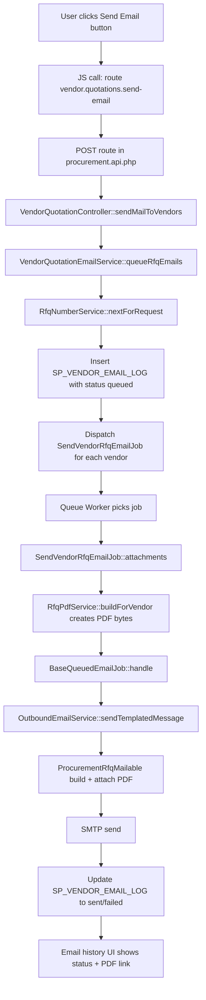

# Vendor Email System - Oracle Checklist + Flowchart

## 1) Oracle SQL Pre-Checklist (Migration run kiye baghair)

Is feature ke liye hamari nayi code side se **koi nayi DB migration mandatory nahi** hai.
Lekin Oracle me kuch objects ka hona zaroori hai.

### 1.1 Required Objects (must exist)

- Table: `SP_VENDOR_EMAIL_LOG`
- Sequence: `SP_VENDOR_EMAIL_LOG_SEQ`
- Table: `SP_VENDORS` (model: `Sp_vendor`)
- Table: `SP_QUOTATION_REQUEST` (model: `QuotationRequest`)

### 1.2 Quick Existence Check SQL

```sql
-- Check table exists
SELECT table_name
FROM user_tables
WHERE table_name IN (
  'SP_VENDOR_EMAIL_LOG',
  'SP_VENDORS',
  'SP_QUOTATION_REQUEST'
);

-- Check sequence exists
SELECT sequence_name
FROM user_sequences
WHERE sequence_name = 'SP_VENDOR_EMAIL_LOG_SEQ';
```

### 1.3 SP_VENDOR_EMAIL_LOG Column Checklist

In columns ka hona important hai:

- `VE_ID` (PK)
- `VE_QR_ID`
- `VE_QR_VERSION`
- `VE_VENDOR_ID`
- `VE_SENT_BY`
- `VE_SENT_AT`
- `VE_EMAIL_SUBJECT`
- `VE_STATUS`  (`queued` / `sent` / `failed`)
- `VE_REMARKS`
- `VE_RFQ_NO`

Check SQL:

```sql
SELECT column_name, data_type, nullable
FROM user_tab_columns
WHERE table_name = 'SP_VENDOR_EMAIL_LOG'
ORDER BY column_id;
```

### 1.4 Recommended Index Checklist

Performance ke liye yeh indexes recommended hain:

- `SP_VENDOR_EMAIL_LOG(VE_QR_ID)`
- `SP_VENDOR_EMAIL_LOG(VE_VENDOR_ID)`
- `SP_VENDOR_EMAIL_LOG(VE_SENT_AT)`

Check SQL:

```sql
SELECT index_name, table_name
FROM user_indexes
WHERE table_name = 'SP_VENDOR_EMAIL_LOG';
```

Optional create (agar missing ho):

```sql
CREATE INDEX IDX_SVEL_QR_ID ON SP_VENDOR_EMAIL_LOG (VE_QR_ID);
CREATE INDEX IDX_SVEL_VENDOR_ID ON SP_VENDOR_EMAIL_LOG (VE_VENDOR_ID);
CREATE INDEX IDX_SVEL_SENT_AT ON SP_VENDOR_EMAIL_LOG (VE_SENT_AT);
```

---

## 2) Queue + Mail Infra Checklist (without migrations)

`.env` me keys verify karein:

- `QUEUE_CONNECTION=database`
- `MAIL_MAILER=smtp`
- `MAIL_HOST=smtp.gmail.com`
- `MAIL_PORT=587`
- `MAIL_USERNAME=...`
- `MAIL_PASSWORD=...` (App Password)
- `MAIL_ENCRYPTION=tls`
- `MAIL_FROM_ADDRESS=...`
- `MAIL_FROM_NAME=...`

Config refresh:

```bash
php artisan config:clear
php artisan cache:clear
```

Queue worker run:

```bash
php artisan queue:work --tries=3 --timeout=120
```

> Note: Agar `QUEUE_CONNECTION=database` use ho raha hai to `jobs` aur `failed_jobs` tables ka hona bhi lazmi hai.
> Agar Oracle me ye tables pehle se nahi hain, DBA se manual Oracle-compatible DDL banwa ke create karwaein.

---

## 3) End-to-End Flow (Button se Email Delivery tak)

### 3.1 User Button Sources

Button yahan se API hit karta hai:

- `resources/views/store_procurement/quotation_request/sp_quotation_submit.blade.php` (line ~776)
- `resources/views/store_procurement/quotation_request/po_list.blade.php` (line ~654)

Dono jagah route name same use hota hai: `vendor.quotations.send-email`

### 3.2 Route

- File: `routes/procurement/procurement.api.php` (line ~103)
- Route:
  `POST /vendor-quotations/send-email`
  -> `VendorQuotationController@sendMailToVendors`

### 3.3 Controller Entry

- File: `app/Http/Controllers/StoreProcurement/VendorQuotationController.php` (line ~469)
- Function: `sendMailToVendors(Request $request, VendorQuotationEmailService $vendorQuotationEmailService)`

Kya hota hai:

1. request validate hoti hai (`request_id`, `vendors[]`)
2. sender username resolve hota hai
3. service call hoti hai: `queueRfqEmails(...)`
4. JSON response aata hai: queued/skipped/rfq_number

### 3.4 Service Layer (Main Orchestration)

- File: `app/Services/StoreProcurement/VendorQuotationEmailService.php`
- Function: `queueRfqEmails(...)`

Kya hota hai:

1. vendor IDs clean + unique
2. quotation request fetch
3. RFQ number generate via `RfqNumberService`
4. har vendor ke liye:
   - Oracle sequence se `VE_ID`
   - `SP_VENDOR_EMAIL_LOG` me status `queued`
   - `SendVendorRfqEmailJob::dispatch(...)`

### 3.5 RFQ Number Service

- File: `app/Services/StoreProcurement/RfqNumberService.php`
- Function: `nextForRequest($requestId)`

Purpose:
- format: `RFQ-{requestId}-{counter}`
- example: `RFQ-123-101`, phir `RFQ-123-102`

### 3.6 Queue Job (Vendor-specific)

- File: `app/Jobs/Email/SendVendorRfqEmailJob.php`
- Extends: `BaseQueuedEmailJob`

Kya hota hai:

1. email blade view data prepare
2. attachment ke liye runtime RFQ PDF banata hai via `RfqPdfService::buildForVendor(...)`
3. base pipeline se email send

### 3.7 Base Queue Job (Common Parent)

- File: `app/Jobs/Email/BaseQueuedEmailJob.php`

Kya common hota hai:

1. retry policy (`tries=3`)
2. send pipeline call to `OutboundEmailService`
3. success/failure pe log status update (`sent` / `failed`)

### 3.8 Outbound Email Sender + Mailable

- Service: `app/Services/Communication/OutboundEmailService.php`
  - method: `sendTemplatedMessage(...)`
- Mailable: `app/Mail/ProcurementRfqMailable.php`

Kya hota hai:

1. Blade render hoti hai
2. PDF bytes attach hote hain
3. SMTP ke zariye email send hoti hai

Template file:
- `resources/views/emails/store_procurement/vendor_rfq.blade.php`

### 3.9 RFQ PDF Source

- File: `app/Services/StoreProcurement/RfqPdfService.php`
- Method: `buildForVendor(...)`
- FPDF se runtime PDF content create hota hai

### 3.10 History + PDF Button UI

- File: `resources/views/store_procurement/quotation_request/partials/email_history_table.blade.php`
- Yahan status badges show hote hain (`sent/failed/pending`)
- PDF preview button route use karta hai:
  `quotation-request.rfq-pdf`

---

## 4) Mermaid Flowchart (Roman Urdu Context)



---

## 5) Short Test Sequence (Roman Urdu)

1. worker start karo: `php artisan queue:work --tries=3 --timeout=120`
2. UI se 1 vendor select karke Send Email press karo
3. `SP_VENDOR_EMAIL_LOG` me pehle `queued` entry check karo
4. kuch seconds baad status `sent` ya `failed` check karo
5. vendor inbox + spam me email check karo
6. email me attached RFQ PDF open karke verify karo

SQL quick check:

```sql
SELECT ve_id, ve_qr_id, ve_vendor_id, ve_status, ve_sent_at, ve_rfq_no
FROM sp_vendor_email_log
WHERE ve_qr_id = :request_id
ORDER BY ve_id DESC;
```

